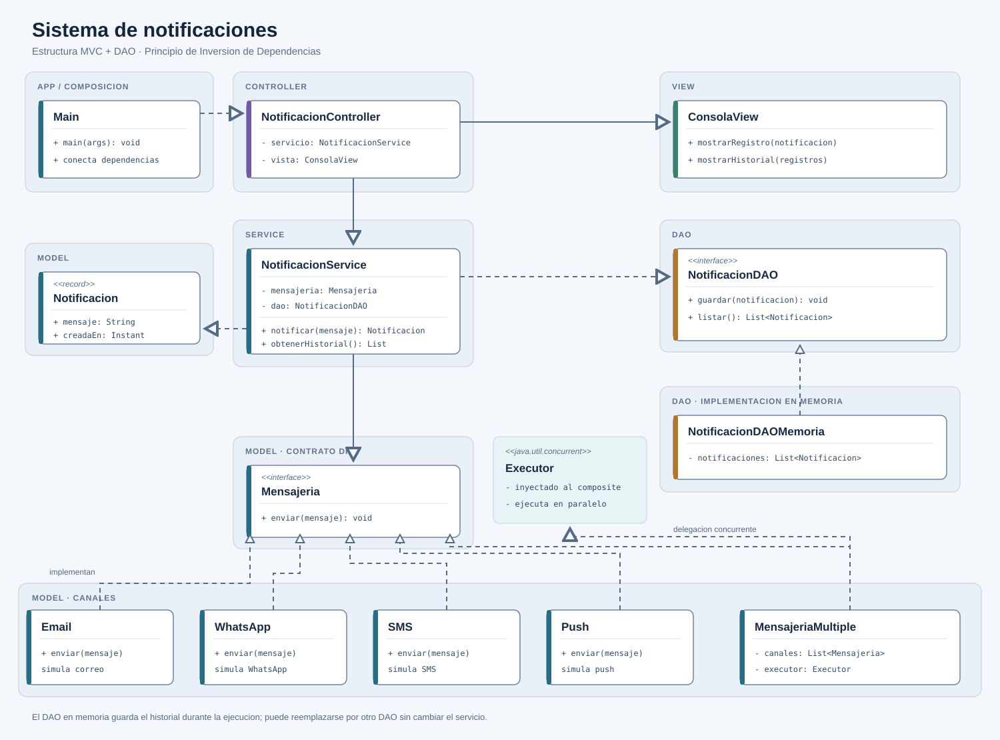
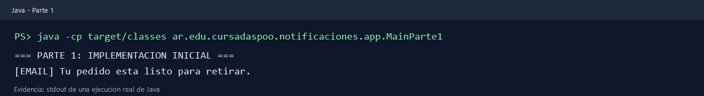
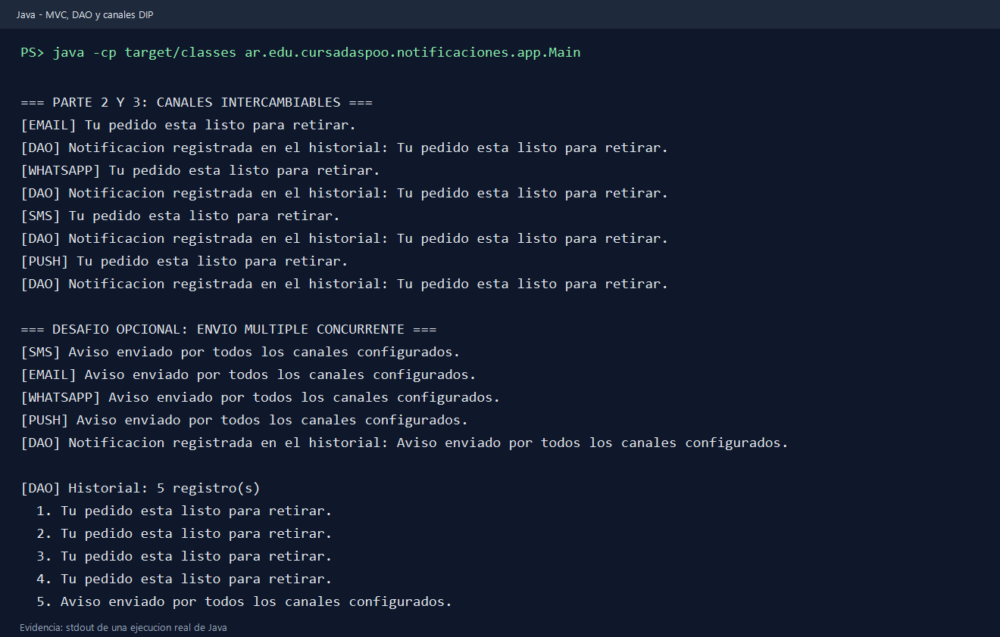

# Sistema de notificaciones — DIP

Trabajo práctico individual de Programación Orientada a Objetos sobre **MVC**, **DAO**, el **Principio de Inversión de Dependencias (DIP)** y la **inyección de dependencias**. El ejemplo usa Java 17, Maven y adaptadores simulados que imprimen cada envío en consola.

## Requisitos

- JDK 17 o superior.
- Maven 3.8 o superior.

## Ejecutar

Desde la raíz del proyecto:

```powershell
mvn clean package
java -cp target/classes ar.edu.cursadaspoo.notificaciones.app.MainParte1
java -cp target/classes ar.edu.cursadaspoo.notificaciones.app.Main
```

`MainParte1` ejecuta la versión acoplada. `Main` demuestra Email, WhatsApp, SMS, Push, el registro con DAO y el envío múltiple concurrente.

## Estructura

```text
sistema-notificaciones-dip/
├── docs/
│   ├── analisis-conceptual.md
│   ├── evidencias/
│   └── uml/
│       ├── diagrama-clases.puml
│       └── diagrama-clases.svg
├── src/main/java/ar/edu/cursadaspoo/notificaciones/
│   ├── app/               # Puntos de entrada y composición de dependencias
│   ├── controller/        # Coordina acciones, servicio y vista
│   ├── dao/               # Contrato y acceso al historial
│   │   └── impl/          # DAO en memoria
│   ├── model/             # Mensajeria, Notificacion y canales
│   │   └── canales/       # Email, WhatsApp, SMS, Push y fan-out
│   ├── parte1/            # Implementación inicial acoplada
│   ├── service/           # Lógica de notificación; depende de Mensajeria y DAO
│   └── view/              # Presentación en consola
├── .editorconfig
├── .gitignore
└── pom.xml
```

La versión inicial se mantiene aislada en `parte1` para compararla con la versión final. `controller.NotificacionController` coordina `service.NotificacionService` y `view.ConsolaView`. El servicio recibe `Mensajeria` y `NotificacionDAO` por constructor; `app.Main` crea las implementaciones concretas. La lógica de notificación no contiene condiciones por canal ni instancia adaptadores.

## Cómo extender

Para agregar otro canal, se crea una clase nueva que implemente `Mensajeria`. La clase `NotificacionService` permanece igual. El punto de composición (`Main`) selecciona e inyecta el nuevo adaptador. La Parte 3 ya incorpora `Push` de esa manera.

El desafío opcional agrega `MensajeriaMultiple`, un adaptador compuesto que recibe una lista de canales y un `Executor`, y distribuye el mismo mensaje concurrentemente. Cada canal sigue dependiendo del mismo contrato.

El DAO guarda cada notificación en `NotificacionDAOMemoria`. Es una implementación en memoria para el TP: el historial se conserva mientras corre el proceso. Una implementación SQL podría reemplazarla respetando `NotificacionDAO`, sin modificar el servicio.

## Diagrama UML



El archivo editable PlantUML está en [`docs/uml/diagrama-clases.puml`](docs/uml/diagrama-clases.puml).

## Entregables

- Implementaciones de las Partes 1, 2 y 3 en `src/main/java`.
- Respuestas conceptuales en [`docs/analisis-conceptual.md`](docs/analisis-conceptual.md).
- Diagrama UML fuente y visual en [`docs/uml/`](docs/uml/).
- Evidencias de ejecución en [`docs/evidencias/`](docs/evidencias/).

### Evidencias

Parte 1, versión acoplada:



Cuatro canales y envío múltiple:



## Alcance

Los canales simulan el envío con `System.out`; no se conectan con proveedores reales de correo, WhatsApp, SMS o push. La intención es mostrar MVC, DAO, DIP, polimorfismo e inyección de dependencias sin credenciales ni servicios externos.
